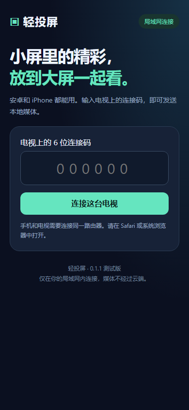
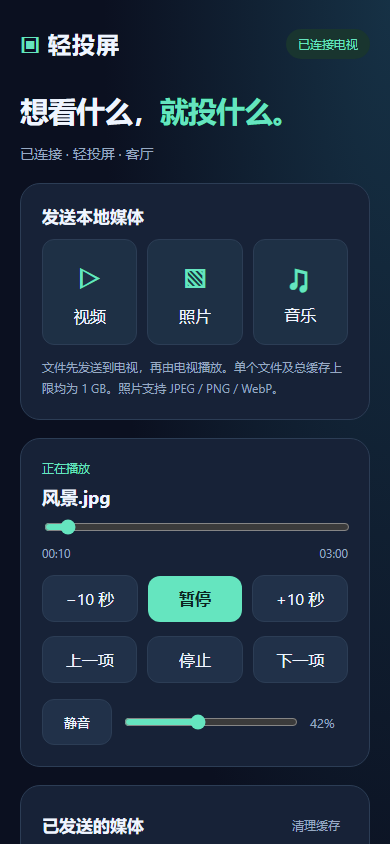

# 轻投屏 · LanCast TV

[](https://github.com/zas921/lancast-tv/actions/workflows/ci.yml)
[](LICENSE)


[English](README.en.md) · [下载测试 APK](https://github.com/zas921/lancast-tv/releases) · [变更记录](CHANGELOG.md) · [参与贡献](CONTRIBUTING.md)

面向大麦等可安装 APK 的 Android 5.1 电视 / 盒子的局域网媒体接收器。只在电视安装应用，安卓和 iPhone 上支持标准 DLNA 的视频 App 可从自身的「TV / 投屏」入口发现电视并控制播放。

当前版本 **0.1.1 测试版**，原生 Java 实现，Android 运行时不依赖第三方库。它实现媒体投屏的标准协议部分；尚未在大麦电视或具体商业视频 App 上实测，不承诺与乐播、当贝的全部功能及兼容范围一致。

## 功能与预览

- 标准 DLNA 设备发现，接收手机视频 App 推送的媒体地址。
- 视频 / 音乐播放、照片显示，以及播放、暂停、进度、音量、静音控制。
- 电视遥控器操作；设备改名、连接码、二维码和缓存清理。
- 安卓 / iPhone 浏览器发送本地媒体，无需安装手机端 APK。

下面是浏览器遥控界面的自动化测试截图，使用模拟电视 API，并非真实电视播放画面。

 

## 安装与使用

1. 从 [Releases](https://github.com/zas921/lancast-tv/releases) 下载 APK，复制到 U 盘，在电视或盒子的文件管理器中打开安装。按设备提示允许该文件管理器安装应用；菜单名称因固件而异。
2. 打开电视上的「轻投屏」，保持首页可见，并确认「DLNA：开启」。默认发现名称是「轻投屏 · 客厅」，可以用遥控器修改。
3. 手机和电视连接同一路由器。在支持标准 DLNA 的视频 App 中打开视频，点「TV / 投屏」，选择上述名称。
4. 可以从手机 App 控制播放 / 暂停、进度、音量；电视遥控器也能控制播放。

手机不需要安装本项目的 APK。安卓和 iPhone 是否能直接从某个视频 App 投屏，取决于该 App 实际支持的接收协议。

### 本地照片、视频、音乐

用手机浏览器扫描电视首页二维码，或访问首页显示的 `http://电视IP:端口` 并输入 6 位连接码。连接后选择文件发送。文件完整上传到电视缓存后开始播放；多选文件可通过「上一项 / 下一项」或列表切换。

- 浏览器入口适用于安卓浏览器和 iPhone Safari，无需手机端 App。
- 照片支持 JPEG / PNG / WebP；HEIC 请先转换为 JPEG。
- 音视频交给电视的系统播放器解码。建议先用 H.264 + AAC 编码的 MP4 验证；扩展名受支持不代表其内部所有编码都受支持。
- 单文件最大 1 GB，总缓存最大 1 GB / 40 项；可在电视或浏览器中清理。浏览器发送的文件仅保存于电视应用缓存，服务重新启动时清理。
- 浏览器连接码用于本地网页控制，不是跨网通用投屏码。刷新连接码会使已有浏览器会话失效。

### 遥控器

- 控制条可见时，用方向键选择按钮，确认键操作。
- 播放中控制条隐藏后，确认键播放 / 暂停；左右键快退 / 快进 10 秒；上下键调整应用音量。
- 返回键结束当前投屏；首页返回键或「退出接收」可停止接收服务。
- 应用音量与电视系统音量共同影响最终音量。

## 功能范围

| 能力 | 实现情况 |
| --- | --- |
| Android 5.1+ 电视 APK、遥控器界面 | 已实现；最低 API 22 |
| 标准 DLNA / UPnP MediaRenderer v1 | 已实现 SSDP、AVTransport、RenderingControl、ConnectionManager |
| 手机 App 发现设备、推送媒体地址 | 已实现；具体 App 和大麦实机待验证 |
| 视频、音乐播放与照片显示 | 已接入 Android 系统解码器；照片支持缩放和 JPEG 方向修正 |
| 暂停、继续、停止、快进、音量、静音 | 已实现 |
| 播放状态回报与 GENA 订阅通知 | 已实现 |
| 安卓 / iPhone 浏览器发送本地媒体 | 已实现；同一局域网内使用 |
| 设备改名、连接码、二维码、缓存清理 | 已实现 |
| AirPlay、iPhone 屏幕镜像、Miracast | 本版不包含 |
| 乐播 Lelink、厂商私有协议、Google Cast | 本版不包含；不能承诺对应 App 的发现或播放 |
| DRM / 会员授权、商业内容平台特殊鉴权 | 本版不包含 |
| 跨网投屏、4K/HDR 转码、多屏同投 | 本版不包含 |

乐播、当贝的商业投屏兼容范围包括其专有协议及长期设备适配工作。本项目不会伪装为获得这些协议或平台授权的产品。需要扩大到仅支持这些接收端的 App 时，应评估其正式 SDK 和授权条件。

## 搜不到电视或无法播放

1. 先确认电视应用已启动、DLNA 已开启、手机与电视在同一局域网，且首页没有发现端口错误。
2. 避免手机连接访客 Wi-Fi；关闭路由器 AP / 客户端隔离，检查局域网组播是否被屏蔽。电视可以使用有线网络，只要与手机互通。
3. 若电视有预装投屏接收软件，先退出它，再重开轻投屏，以排除 SSDP 端口冲突。
4. 若支持标准 DLNA 的播放器能发现，而某商业 App 不能发现，优先检查该 App 的协议限制；不代表更换连接码可以解决。
5. 若能发现但播放失败，先用普通 H.264 / AAC MP4 测试。过期的媒体 URL、自定义请求头、DRM、老电视的 TLS 或解码能力，均可能造成失败。
6. iPhone 的「屏幕镜像」属于 AirPlay，不会列出此 DLNA 接收器。请使用视频 App 的 DLNA 投屏入口；本地媒体也可以使用本项目的浏览器入口。

## 隐私与网络

本项目不连接云端服务，不发送统计数据。浏览器文件直接发送至电视；DLNA 在线视频由电视请求手机 App 提供的媒体地址，因此在线内容仍会访问对应媒体服务器。

浏览器控制需要配对，连接码尝试有频率限制，会话有效期为 12 小时。网页仅允许同源请求；上传、请求头、XML、连接数量和缓存均设置上限。DLNA 标准本身允许同一局域网内的设备直接控制播放，不使用浏览器连接码；不可信网络上应关闭 DLNA 或退出接收。局域网控制入口使用 HTTP，不应将端口映射到公网。

## 源码与离线打包

运行时代码不依赖第三方 Android 库。工作目录包含 Android Studio / Gradle 工程配置，以及已经实际验证过的直接 SDK 打包脚本。

打包所需：JDK 17、Android SDK Platform 35、Build Tools 34.0.0、Windows PowerShell 5.1 或 PowerShell 7。SDK 已安装后，直接打包无需下载 Gradle 或 Android 依赖。在 PowerShell 中执行：

```powershell
.\build.ps1 -SdkPath '你的Android SDK路径' -JavaPath '你的JDK路径'
```

输出为 `dist/LanCast-TV-0.1.1.apk` 和 `dist/SHA256SUMS.txt`。也可设置 `JAVA_HOME` 和 `ANDROID_HOME` / `ANDROID_SDK_ROOT` 后直接运行 `./build.ps1`。脚本按当前操作系统选择工具，并隔离每次编译输出，防止旧 class 文件混入 APK。

脚本生成开发签名并启用 Android 5.1 所需的 v1 签名。签名保存在 `build/lancast-debug.keystore`，请在本地备份以便安装后续更新，**不要提交签名密钥**。仓库忽略 `build/`、`dist/`、密钥和本地配置。源码不包含预编译 APK；下载包见 Releases，CI 包见 Actions 构建产物。

CI 每次运行可能产生不同的开发签名，不保证能覆盖安装其他构建的 APK。正式发行应使用维护者保存的稳定签名。当前包使用 targetSdk 28，面向旧电视侧载测试，未准备商店上架。

Android Studio 可打开根目录；Gradle 路径需要自行安装 Gradle，并联网获取 Android Gradle Plugin 8.7.3。此路径未在本机运行验证，本机交付包由 `build.ps1` 生成。

## 验证记录

本地检查通过，不等同于真实电视或具体手机 App 的端到端验收：

- `test.ps1`：158 项协议与回归检查；`test.ps1 -Multicast`：161 项。覆盖 HTTP 边界校验、部分内容读取、XML 安全、DLNA SOAP 播控 / 错误码、SCPD 引用、GENA 通知、慢回调期间的状态更新、拒收重试与订阅续期 / 取消。组播检查额外验证真实局域网 SSDP 请求与响应。
- `tests/browser-smoke.cjs`：14 项浏览器检查，使用模拟电视 API，覆盖错误连接码、配对、多文件上传、自动播放、切换、暂停、音量、进度、断开和移动 / 桌面宽度适配。它不验证 Android 服务或实际媒体解码。
- `tests/verify-qr.py`：生成的二维码 1,089 个模块与 ReportLab 的独立实现全部一致。
- Android SDK 检查最低版本为 API 22、目标 API 28，版本为 0.1.1；`apksigner verify` 验证 v1 / v2 / v3 签名通过。
- 尚未安装到大麦电视，也未实测安卓 / iPhone 上的具体商业视频 App。欢迎通过兼容性 Issue 提交实机结果。

测试依赖通过锁文件固定版本，不依赖特定开发工具的运行库：

```powershell
.\test.ps1
.\test.ps1 -Multicast
npm ci --ignore-scripts
npx playwright install chromium
npm test
python -m pip install -r requirements-test.txt
python .\tests\verify-qr.py
```

浏览器测试需要 Node.js 22+；可用 `CHROME_PATH` 指向已有 Chrome。QR 校验依赖 Python 及 ReportLab，需先运行 JVM 测试生成 `build/qr-test.svg`。

GitHub Actions 执行 JVM、QR、浏览器检查，并在 Ubuntu / Windows 上打包开发签名 APK。CI 不进行商业视频 App 或真实电视验收，也不默认执行依赖本地网络的组播检查。

## 许可证

[MIT](LICENSE)。欢迎贡献；问题报告和安全反馈分别参见 [CONTRIBUTING.md](CONTRIBUTING.md) 与 [SECURITY.md](SECURITY.md)。

参考协议与平台资料：[UPnP 标准](https://openconnectivity.org/developer/specifications/upnp-resources/upnp/)、[Android 支持的媒体格式](https://developer.android.com/media/platform/supported-formats)。
